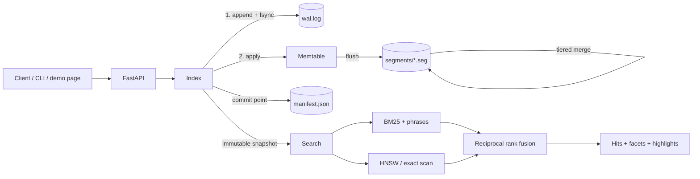

# hybrid-search

[Português](README.pt-BR.md) | English

[](https://github.com/FrancisWorld/hybrid-search/actions/workflows/ci.yml)
[](LICENSE)

A hybrid search engine written from scratch in Python: a BM25 inverted index with varint/delta-compressed postings, an HNSW vector index in NumPy, reciprocal rank fusion, and a segment + WAL + merge storage layer with crash recovery. No external search library, no API key, no model download.

## Why it exists / what is hard about it

Search engines look simple until you build the storage layer. The parts this project implements and tests rather than wraps:

- **Compressed postings.** Doc ids are delta-coded, frequencies and positions are varint-coded in separate blocks, so scoring never pays for positions and phrase queries decode them only when needed.
- **Segments, WAL, manifest.** Writes go to a CRC-framed write-ahead log, then a memtable; flushes create immutable, checksummed segment files; a single atomically replaced manifest is the commit point. Recovery truncates a torn WAL tail and replays only records newer than the manifest checkpoint.
- **Tiered merging** at the postings level (no re-analysis), which also reclaims deleted documents.
- **HNSW with filters.** Graph search takes an allow-mask (live docs AND filter matches); very selective filters fall back to an exact scan.
- **Hybrid ranking.** Lexical top-N and vector top-N are fused with RRF; filters are applied inside both retrievers, not after.
- **Query language** with phrases (stop-word gaps respected), `+`/`-`/`AND`/`OR`/`NOT`, field scoping and grouping, plus highlighting and snippets that re-analyse text so `Running` highlights for `run`.

## Architecture



Each segment file holds: stored documents (zlib), term dictionary, postings, per-field lengths, keyword/number columns for filters and facets, the float32 vector matrix and, above 64 documents, an HNSW graph. Sections are 8-byte aligned and individually CRC-checked.

## Quickstart

Requires Python 3.12 and [uv](https://docs.astral.sh/uv/).

```bash
uv sync
uv run hybrid-search sample ./data/index --dataset en      # bundled 38-doc corpus
uv run hybrid-search search ./data/index 'espreso presure' -k 3
uv run hybrid-search search ./data/index '"write ahead" -replication' --mode lexical --facet category
uv run hybrid-search search ./data/index marathon --filter 'year>=2020' -k 2
uv run hybrid-search serve ./data/index                     # http://127.0.0.1:8000
uv run hybrid-search eval --dataset pt                      # nDCG / MRR table
```

Or with Docker: `docker compose up --build` (data lives in a named volume; the app flushes on SIGTERM).

Real output of the commands above:

```
12 matches (hybrid, 3.4 ms)
 1. coffee-espresso-machine  0.0164  [lex#- vec#1]  Espresso machine pressure
 2. volcano-ash              0.0161  [lex#- vec#2]  Volcanic ash hazards
 3. bread-proofing           0.0159  [lex#- vec#3]  Proofing and fermentation

1 matches (lexical, 1.8 ms)
 1. databases-wal  17.7560  [lex#1 vec#-]  Write-ahead logging
    [Write]-[ahead] logging
category: databases (1)
```

The typo query finds the espresso document only through the vector side (character n-grams), while the lexical side finds nothing; hybrid still returns weak vector-only neighbours below it, because RRF has no notion of "too far".

### HTTP API

| Method | Path | Purpose |
|---|---|---|
| POST | `/documents` | bulk upsert (`{"documents":[{id, fields, meta}]}`, max 1000, all-or-nothing) |
| GET / DELETE | `/documents/{id}` | fetch / delete |
| POST | `/search` | `query`, `mode` (`lexical`/`vector`/`hybrid`), `k`, `offset`, `filters`, `facets`, `highlight`, `candidates`, `rrf_k`, `min_similarity` |
| POST | `/flush`, `/merge?force=` | checkpoint / run merge policy |
| GET | `/stats`, `/healthz`, `/` | statistics, liveness, demo page |

Errors are structured: `{"error": {"code": "query_syntax_error", "message": "..."}}` with 400 for bad input, 409 if the directory is locked, 503 if closed.

## Relevance evaluation

`hybrid-search eval` runs graded judgements (written by hand for this repo, so small and biased) through each mode. Measured on the bundled datasets, k=10:

| dataset | mode | nDCG@10 | MRR | recall@10 |
|---|---|---|---|---|
| en (38 docs, 14 queries) | lexical | 0.864 | 0.964 | 0.714 |
| | vector | 0.885 | 1.000 | 0.750 |
| | hybrid | 0.899 | 1.000 | 0.750 |
| pt (25 docs, 12 queries) | lexical | 0.884 | 0.917 | 0.847 |
| | vector | 0.909 | 0.903 | 0.931 |
| | hybrid | 0.921 | 0.917 | 0.931 |

With 25-38 documents and a few queries these numbers only show the harness works and that fusion is not worse than its inputs here; they are not evidence about large corpora. The "embedder" is feature hashing over stems, word bigrams and character trigrams, so it captures morphology and typos but not synonyms ("car" vs "automobile"). Swap in a learned model by implementing the `Embedder` protocol.

## Measured performance and recall

Apple M1 laptop, 8 GB, single process, `benchmarks/measure.py` (random unit vectors, 64 dims, 5000 points, M=16, efConstruction=100):

| ef | recall@10 | ms/query |
|---|---|---|
| 16 | 0.574 | 0.35 |
| 32 | 0.759 | 0.46 |
| 64 | 0.923 | 0.70 |
| 128 | 0.986 | 1.13 |

Exact NumPy brute force took 0.14 ms/query on the same data, i.e. at this size a single matrix product beats the pure-Python graph walk. HNSW only pays off at much larger N, which this benchmark does not reach. Random Gaussian vectors are also a hard case for HNSW. Graph build: 536 vectors/s.

Engine: 5000 synthetic 60-word documents indexed in 26.6 s (188 docs/s, no fsync, includes analysis, hashing embedding, HNSW builds and merges). Query p50 on that index: lexical 4.9 ms, vector 6.3 ms, hybrid 6.8 ms. Pure Python indexing is the bottleneck; this is a teaching-grade engine, not a Lucene replacement.

## Design decisions and trade-offs

- **State-based WAL records** (`put` replaces, `delete` removes) make replay idempotent, so the checkpoint can be written before the log is truncated and any crash in between is safe. Vectors are recomputed on replay, which assumes a deterministic embedder.
- **Snapshots instead of reader locks.** Searches grab an immutable `(segments, tombstone masks, memtable build)`; flush and merge swap state under a short lock. Merged-away files are unlinked while readers may still hold mappings (POSIX semantics).
- **Memtable is a real segment** rebuilt lazily after writes, so one code path serves fresh and old data; the cost is O(memtable) per search after a write.
- **Global BM25 statistics** (N, df, avgdl) across segments so scores do not depend on segmentation (tested against a naive reference). df still counts tombstoned documents until a merge, as Lucene does.
- **Per-field BM25 summed with boosts**, not true BM25F.
- **Facets** count the lexical match set plus vector candidates, after filters.
- **Single writer per directory** (`flock`), many reader threads. POSIX only.

## Testing strategy

`uv run pytest` (about 280 tests, ~98% line coverage, run with `--cov`):

- Hypothesis properties: varint/delta/postings round-trip, WAL recovery yields exactly a record prefix for every truncation point, parser never raises anything but `QueryError`, must/must-not set logic.
- BM25 scores equal a naive from-the-formula implementation, for one segment and for several, including phrase matching.
- HNSW recall vs brute force (measured 0.997 at n=1200, ef=64 in the test), filtered search, serialisation.
- Crash tests on real directories: copy the files of a live index (a "kill -9" snapshot), cut the WAL mid-record, fail the manifest write, fail the WAL reset, crash after a merge commit, replay repeatedly.
- Concurrency: 4 writers (upserts and deletes) + 2 readers + a flush/merge loop on a real directory; final state is compared to a model.
- Relevance floors on the bundled datasets; API tests including HTML escaping.

Lint and types: `uv run ruff check . && uv run ruff format --check . && uv run mypy` (strict).

## Limitations

- Pure-Python hot paths: slow indexing, no block-max/skip lists, no query-time caching.
- Vector side is lexical-subword hashing, not semantic.
- Portuguese stemmer is a compact RSLP-style rule set, not full RSLP or Snowball; the English one is the original Porter algorithm.
- One language per index; no fuzzy/prefix/wildcard queries; tombstones are per segment and rewritten with each manifest.
- Not benchmarked beyond 5000 documents; not run in production by anyone.

## License

MIT, see [LICENSE](LICENSE).

---
Built by [Chico Oliveira](https://github.com/FrancisWorld)
