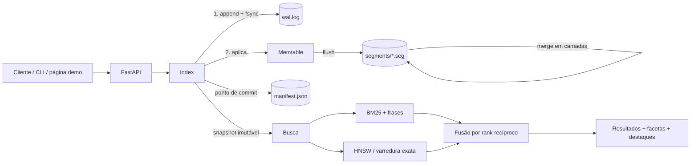

# hybrid-search

Português | [English](README.md)

[](https://github.com/FrancisWorld/hybrid-search/actions/workflows/ci.yml)
[](LICENSE)

Um motor de busca híbrida escrito do zero em Python: índice invertido BM25 com postings comprimidos (varint/delta), índice vetorial HNSW em NumPy, fusão por rank recíproco (RRF) e uma camada de armazenamento com segmentos, WAL e merge, com recuperação após falhas. Sem biblioteca de busca, sem chave de API, sem download de modelo.

## Por que existe / o que é difícil

Busca parece simples até você construir o armazenamento. O que este projeto implementa e testa, em vez de embrulhar:

- **Postings comprimidos.** Ids de documentos em delta; frequências e posições em varint, em blocos separados. O cálculo de score nunca decodifica posições; só consultas de frase pagam por elas.
- **Segmentos, WAL, manifesto.** Escritas vão para um log com CRC, depois para um memtable; o flush cria segmentos imutáveis e com checksum; um único manifesto substituído de forma atômica é o ponto de commit. A recuperação trunca a cauda corrompida do WAL e reaplica só o que é mais novo que o checkpoint.
- **Merge em camadas** direto nos postings (sem reanalisar o texto), que também recupera espaço de documentos apagados.
- **HNSW com filtros.** A busca no grafo recebe uma máscara de permitidos (vivos E que passam no filtro); filtros muito seletivos caem para varredura exata.
- **Ranking híbrido.** Top-N lexical e top-N vetorial são fundidos com RRF; os filtros entram dentro dos dois recuperadores, não depois.
- **Linguagem de consulta** com frases (lacunas de stop words respeitadas), `+`/`-`/`AND`/`OR`/`NOT`, campos e grupos, além de destaque e snippets que reanalisam o texto (`Correndo` destaca para `correr`).

## Arquitetura



Cada segmento guarda: documentos (zlib), dicionário de termos, postings, tamanhos por campo, colunas de keywords/números para filtros e facetas, a matriz float32 de vetores e, a partir de 64 documentos, um grafo HNSW. As seções são alinhadas a 8 bytes e têm CRC próprio.

## Início rápido

Requer Python 3.12 e [uv](https://docs.astral.sh/uv/).

```bash
uv sync
uv run hybrid-search sample ./data/index --dataset pt      # corpus pt de 25 docs
uv run hybrid-search search ./data/index "eclipse do sol" --mode lexical -k 1
uv run hybrid-search serve ./data/index                     # http://127.0.0.1:8000
uv run hybrid-search eval --dataset pt                      # tabela nDCG / MRR
```

Ou com Docker: `docker compose up --build` (os dados ficam num volume nomeado; o app faz flush ao receber SIGTERM). Os comandos e a saída de exemplo mais completos estão no [README em inglês](README.md#quickstart); a API HTTP também.

Parâmetros de busca: `mode` (`lexical`, `vector`, `hybrid`), `k`, `offset`, `filters` (ex.: `{"category": ["a","b"], "year": {"gte": 2020}}`), `facets`, `highlight`, `candidates`, `rrf_k`, `min_similarity`. Erros são estruturados (`{"error": {"code": ..., "message": ...}}`).

## Avaliação de relevância

`hybrid-search eval` roda julgamentos graduados (escritos à mão para este repositório, portanto pequenos e enviesados). Medido, k=10:

| conjunto | modo | nDCG@10 | MRR | recall@10 |
|---|---|---|---|---|
| en (38 docs, 14 consultas) | lexical | 0,864 | 0,964 | 0,714 |
| | vetorial | 0,885 | 1,000 | 0,750 |
| | híbrido | 0,899 | 1,000 | 0,750 |
| pt (25 docs, 12 consultas) | lexical | 0,884 | 0,917 | 0,847 |
| | vetorial | 0,909 | 0,903 | 0,931 |
| | híbrido | 0,921 | 0,917 | 0,931 |

Com 25-38 documentos esses números só mostram que o harness funciona e que a fusão não fica pior que suas entradas aqui; não dizem nada sobre corpora grandes. O "embedder" é feature hashing sobre radicais, bigramas de palavras e trigramas de caracteres: captura morfologia e erros de digitação, mas não sinônimos. Para um modelo aprendido, implemente o protocolo `Embedder`.

## Desempenho e recall medidos

MacBook Apple M1, 8 GB, um processo, `benchmarks/measure.py` (vetores unitários aleatórios, 64 dimensões, 5000 pontos, M=16, efConstruction=100):

| ef | recall@10 | ms/consulta |
|---|---|---|
| 16 | 0,574 | 0,35 |
| 32 | 0,759 | 0,46 |
| 64 | 0,923 | 0,70 |
| 128 | 0,986 | 1,13 |

A força bruta exata em NumPy levou 0,14 ms/consulta nos mesmos dados: nesse tamanho, um produto de matrizes vence a caminhada em Python puro pelo grafo. O HNSW só compensa com N bem maior, que o benchmark não alcança. Construção do grafo: 536 vetores/s.

Motor: 5000 documentos sintéticos de 60 palavras indexados em 26,6 s (188 docs/s, sem fsync). Mediana de consulta: lexical 4,9 ms, vetorial 6,3 ms, híbrido 6,8 ms. A indexação em Python puro é o gargalo; é um motor didático, não um substituto do Lucene.

## Decisões de projeto

- **Registros de WAL baseados em estado** (`put` substitui, `delete` remove) tornam o replay idempotente: o checkpoint pode ser gravado antes de truncar o log, e qualquer queda entre os dois é segura. Os vetores são recalculados no replay (exige embedder determinístico).
- **Snapshots em vez de locks de leitura.** Buscas usam uma visão imutável; flush e merge trocam o estado sob um lock curto.
- **O memtable é um segmento de verdade**, reconstruído sob demanda: um só caminho de código para dados novos e antigos, ao custo de O(memtable) por busca após uma escrita.
- **Estatísticas BM25 globais** entre segmentos: o score não depende de como os documentos foram divididos (testado contra uma implementação ingênua). O df ainda conta documentos apagados até o merge.
- **BM25 por campo somado com boosts**, não BM25F de verdade.
- **Durabilidade.** Todo arquivo criado, renomeado ou truncado (WAL, segmentos, manifesto, config) é seguido de fsync do diretório; os testes espionam `os.fsync`. Consultas limitadas a 2048 caracteres em todos os modos e corpo das requisições a `HYBRID_SEARCH_MAX_BODY` bytes (413). O decodificador de postings rejeita blocos malformados com `CodecError`.
- **Um escritor por diretório** (`flock`), várias threads de leitura. Apenas POSIX.

## Estratégia de testes

`uv run pytest` (cerca de 280 testes, ~98% de cobertura de linhas): propriedades com Hypothesis (codec, recuperação do WAL para qualquer ponto de truncamento, parser), BM25 contra referência ingênua, recall do HNSW contra força bruta, testes de queda em diretórios reais (WAL cortado, falha na escrita do manifesto, falha ao truncar o WAL, queda após merge, replays repetidos), concorrência com escritores, leitores e flush/merge em loop, pisos de relevância e testes de API (inclusive escape de HTML).

Lint e tipos: `uv run ruff check . && uv run ruff format --check . && uv run mypy` (strict).

## Limitações

- Caminhos quentes em Python puro: indexação lenta, sem skip lists/block-max.
- O lado vetorial é hashing de subpalavras, não semântico.
- O stemmer português é um conjunto compacto de regras no estilo RSLP, não o RSLP completo nem o Snowball; o inglês é o Porter original.
- Um idioma por índice; sem consultas fuzzy/prefixo/curinga.
- Não medido além de 5000 documentos; ninguém o usa em produção.

## Licença

MIT, veja [LICENSE](LICENSE).

---
Built by [Chico Oliveira](https://github.com/FrancisWorld)
